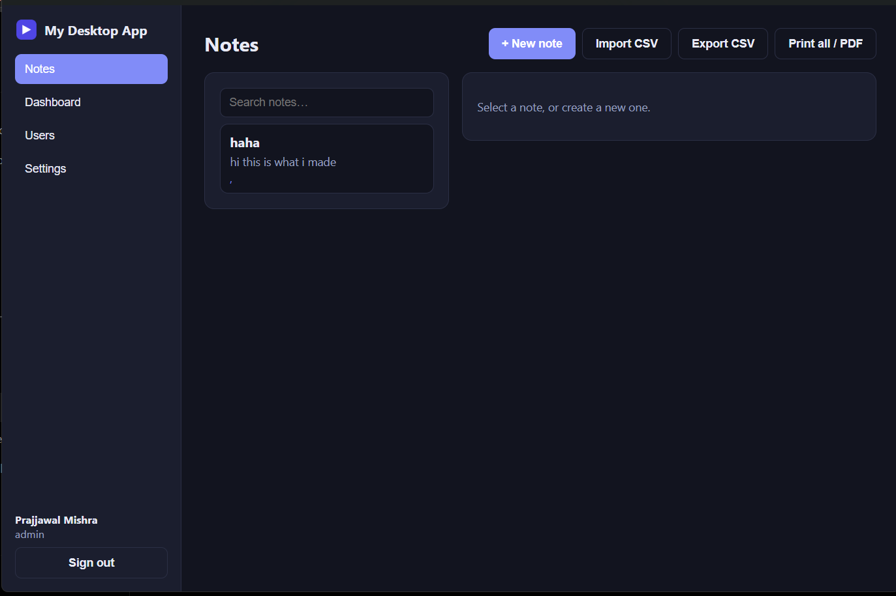
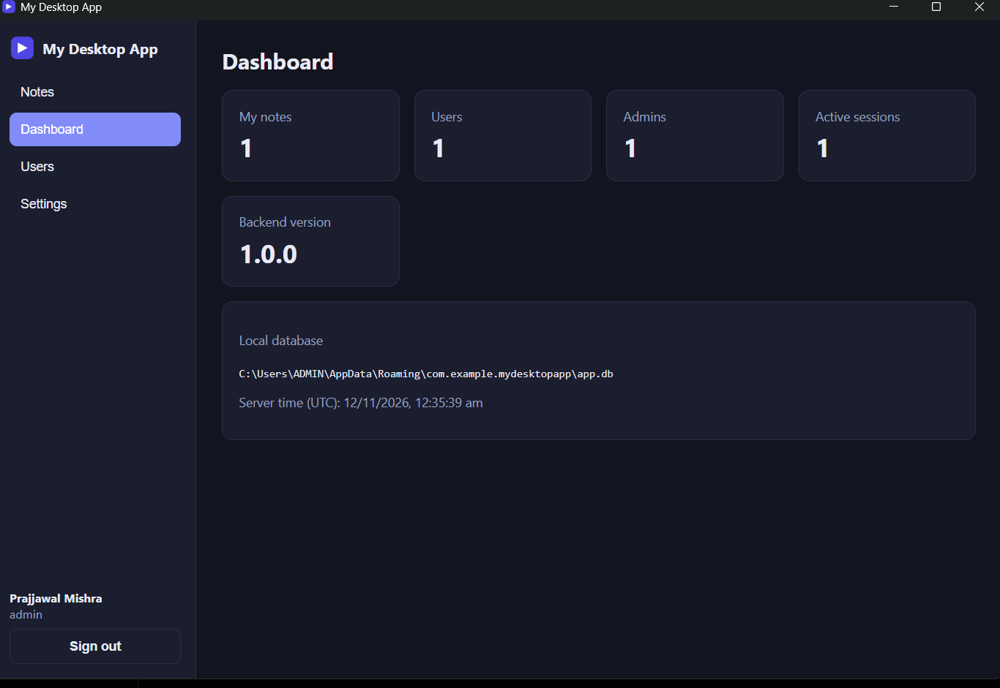
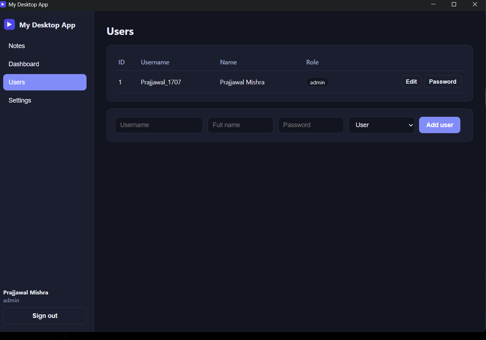

# My Desktop App — A Simple Notes App for Windows

**Write your thoughts. Close the app. Your notes stay yours.**

A lightweight, simple and offline-first desktop notes application built with **Tauri, React, Python (FastAPI) and SQLite**.

No complicated productivity tools. No unnecessary features. Just a simple place to write, organize and keep your notes.

The application runs locally on your computer. Your notes are never sent to a cloud server. The installer bundles the Python backend, so end users do not need to install Python, Node.js or Rust.

## Screenshots

### Notes


### Dashboard


### User Management


### Settings


## Features

- **Simple note-taking:** Create, edit, delete, pin, tag and search your notes.
- **Multiple accounts:** The first launch creates an administrator account. Admins can add, edit and delete users and reset passwords.
- **Private notes:** Notes are stored locally and remain private to each user account within the application.
- **CSV Import & Export:** Export notes to CSV for use in Excel or other spreadsheet applications. Import notes from CSV files.
- **PDF Support:** Print individual notes or all notes. Use Microsoft Print to PDF to save them as PDF files.
- **Light & Dark Themes:** Choose your preferred appearance.
- **Fully Offline:** No internet connection is required to write or manage notes.
- **Lightweight Desktop App:** Built with Tauri and a bundled Python backend.

## Download and Install

1. Visit the [Releases](../../releases) page.
2. Download the latest Windows installer: `MyDesktopApp_x.y.z_x64-setup.exe`.
3. Double-click the installer.
4. Follow the installation instructions.
5. Open My Desktop App from the Windows Start menu.
6. Create your administrator account on first launch.

The application installs for your Windows user account and does not normally require administrator privileges.

### Windows Security Notice

The installer is currently unsigned. Windows SmartScreen may display a warning.

Only install releases downloaded from this official repository, and verify their published checksums when available.

### Updating the Application

Before installing a new version:

- Close the application completely.
- Run the new installer.
- Open the updated application.

Your existing database should remain in place when the application identifier stays unchanged. Always create a backup before updating.

### Where Are My Notes Stored?

Your application data is stored locally at:

`%APPDATA%\com.example.mydesktopapp\`

The folder contains:

- `app.db` — Your SQLite database.
- `logs\` — Application and backend logs.

**Important Data Safety Notice**

This version stores notes locally on your computer. It does not currently provide automatic cloud backup or account-based recovery.

If Windows is reset, your computer is damaged, or the application data folder is deleted, your notes may be lost.

Please regularly back up `app.db` or export your notes to CSV and store a copy somewhere outside your computer.

The application identifier in `src-tauri/tauri.conf.json` determines the data folder name.

## How It Works

```text
React + TypeScript (Frontend)
          |
          | HTTP / JSON
          | 127.0.0.1
          | Random port + secret token
          |
          v
Python + FastAPI (Backend)
          |
          v
SQLite (Local Database)

          ^
          |
Tauri + Rust
(Desktop window and backend process management)
```

### Application Architecture

- On launch, Rust selects an available local port and generates a random secret token.
- Rust starts the bundled Python backend using a PyInstaller executable packaged as a Tauri sidecar.
- The React frontend obtains the port and token from Rust.
- The frontend waits for the backend health endpoint and sends the API token with requests.
- Users authenticate separately using their account credentials and session tokens.
- The backend listens only on `127.0.0.1`.
- CORS is restricted to the application's configured origins.
- When the application closes, Rust stops the backend process.
- The backend also has its own shutdown mechanism if the application exits unexpectedly.

## Project Structure

```text
├── frontend/
│   └── src/
│       ├── pages/
│       ├── components/
│       ├── context/
│       └── services/
│
├── backend/
│   ├── app/
│   │   ├── api/v1/
│   │   ├── models/
│   │   ├── schemas/
│   │   ├── services/
│   │   ├── repositories/
│   │   └── core/
│   ├── tests/
│   └── run.py
│
├── src-tauri/
├── scripts/
│   └── build-backend.py
│
├── docs/
├── build-windows.bat
└── .github/
    └── workflows/
        └── build-windows.yml
```

## Build It Yourself

### Prerequisites

| Tool | Purpose |
|---|---|
| Node.js 18+ | Frontend and Tauri CLI |
| Python 3.10+ | Backend and PyInstaller |
| Rust | Tauri desktop application |
| Visual Studio C++ Build Tools | Windows native compilation |
| WebView2 | Windows application rendering |

Installation links:

- [Node.js](https://nodejs.org/)
- [Python](https://www.python.org/)
- [Rust](https://rustup.rs/)
- [Tauri Prerequisites](https://tauri.app/start/prerequisites/)

### Build the Windows Installer

The easiest way is to double-click:

`build-windows.bat`

The first build may take approximately 5–15 minutes.

The installer will be generated at:

```text
src-tauri\target\release\bundle\nsis\
MyDesktopApp_1.0.0_x64-setup.exe
```

### Using the Command Line

```bash
npm run setup
npm run build
```

### Development With Hot Reload

First, create the development sidecar placeholder:

```bash
npm run dev:sidecar-placeholder
```

Start the backend in terminal 1:

```bash
npm run dev:backend
```

Start the frontend and desktop window in terminal 2:

```bash
npm run dev
```

You can also access the frontend through your browser:

[http://localhost:1420](http://localhost:1420)

For browser development, run:

```bash
npm run dev --prefix frontend
```

In development mode, the backend is started separately so you can access live logs and make changes easily.

In production, Tauri starts the bundled backend automatically.

### Run Tests

```bash
npm run test:backend
```

### Build Using GitHub Actions

You can also build the Windows installer without installing the complete development environment locally.

1. Fork this repository.
2. Open the Actions tab.
3. Select Build Windows Installer.
4. Click Run Workflow.
5. Wait for the build to finish.
6. Download the generated installer from the workflow artifacts.

Pushing a version tag such as `v1.0.1` can also trigger the workflow.

## Make It Your Own

You are welcome to customize the application for your personal use.

### 1. Rename the Application

Edit the following values in:

`src-tauri/tauri.conf.json`

- `productName`
- Window `title`
- `identifier`

For example:

`com.yourname.notes`

**Important:** Changing the identifier changes the application data directory. Do not change it for existing users without providing a database migration or backup-and-restore process.

### 2. Change the Application Icon

Prepare a 1024 × 1024 PNG image and run:

```bash
npm run tauri icon path/to/your-logo.png
```

Rebuild the application after changing the icon.

### 3. Change the Version

Update the version in:

- `src-tauri/tauri.conf.json`
- `src-tauri/Cargo.toml`
- `package.json`

Follow semantic versioning when publishing releases.

## Add New Features

For example, if you want to add a Tasks page:

### Backend

Work inside `backend/app/`.

1. Add a database model.
2. Register the model in `models/__init__.py`.
3. Add request and response schemas.
4. Add repository queries.
5. Implement business logic in services.
6. Create API routes.
7. Register the router in `main.py`.
8. Add tests in `backend/tests/`.

### Frontend

Work inside `frontend/src/`.

1. Add API calls in `services/`.
2. Use `apiGet`, `apiPost`, `apiPut` and `apiDelete` from `api.ts`.
3. Create the new page inside `pages/`.
4. Update the `Page` type in `types/index.ts`.
5. Add the page to `NAV` in `components/layout/Layout.tsx`.
6. Render the page in `App.tsx`.

**Database migrations:** New tables may be created automatically using SQLAlchemy `create_all`. Changes to existing database tables should use Alembic migrations to preserve existing user data.

## Other Platforms

The application is currently tested on **Windows 11**.

macOS and Linux support have not yet been tested.

To explore support for other platforms, change the Tauri bundle targets and build the Python backend separately for each operating system and supported CPU architecture.

## API Overview

All API endpoints require the `X-API-Token` header, except the health endpoint.

Most authenticated endpoints also require:

`Authorization: Bearer <session token>`

| Area | Endpoints |
|---|---|
| Health | `GET /health` |
| Authentication | `/api/v1/auth/` |
| Users | `/api/v1/users/` |
| Notes | `/api/v1/notes/` |
| Dashboard | `/api/v1/dashboard/` |
| Settings | `/api/v1/settings/` |

Important authentication endpoints:

- `GET /api/v1/auth/status`
- `POST /api/v1/auth/register`
- `POST /api/v1/auth/login`
- `POST /api/v1/auth/logout`
- `GET /api/v1/auth/me`
- `POST /api/v1/auth/change-password`

Notes endpoints include:

- `GET /api/v1/notes/?q=`
- `POST /api/v1/notes/`
- `GET /api/v1/notes/{id}`
- `PUT /api/v1/notes/{id}`
- `DELETE /api/v1/notes/{id}`
- `GET /api/v1/notes/export`
- `POST /api/v1/notes/import`

During development, interactive API documentation is available at:

[http://127.0.0.1:8765/docs](http://127.0.0.1:8765/docs)

Use the development API token when accessing protected endpoints.

## Troubleshooting

### Backend Unavailable

Check the backend log:

`%APPDATA%\com.example.mydesktopapp\logs\backend.log`

Security software may block the bundled `backend.exe`. Verify the executable's source before allowing it.

### Installer Cannot Close the Application

Close the application completely.

If necessary, use PowerShell:

```powershell
taskkill /F /IM my-desktop-app.exe
taskkill /F /IM backend.exe
```

Then run the installer again.

### Missing Backend Sidecar During Development

Run:

```bash
npm run dev:sidecar-placeholder
```

### Port 1420 Already in Use

Close other Vite or Tauri development sessions.

Alternatively, change the port in:

- `frontend/vite.config.ts`
- `src-tauri/tauri.conf.json`

### Reset Application Data

Close the application and delete:

`%APPDATA%\com.example.mydesktopapp\`

**Warning:** This permanently deletes your local database, users, notes and settings. Back up your data before doing this.

## Known Limitations

- Windows 11 is the currently tested operating system.
- The installer is not code-signed.
- CSV is supported, but native Excel `.xlsx` export is not currently available.
- There is no automatic cloud backup or synchronization.
- There is no automatic update checker.
- Database schema changes require proper migrations to protect existing data.

## Technology Stack

- React 18
- TypeScript
- Vite
- Tauri 2
- Rust
- Python
- FastAPI
- SQLAlchemy
- Uvicorn
- SQLite
- PyInstaller

## Contributing

Suggestions, bug reports and feedback are welcome.

You can:

- Report bugs through GitHub Issues.
- Suggest new features.
- Share feedback about the user experience.
- Explore the code and customize your personal copy.

Please run the following commands before submitting changes:

```bash
npm run test:backend
npm run build --prefix frontend
```

## License and Usage

This project is distributed under a **Personal Use, Non-Commercial License**.

You are permitted to:

- Download and use the application for personal purposes.
- Modify the source code for personal, non-commercial use.
- Customize the interface and application features for yourself.
- Build personal versions of the application.

You are not permitted to:

- Sell the application or modified versions.
- Use the application or its source code for commercial purposes.
- Distribute paid versions or offer the application as a commercial service.
- Claim the original work as your own.

Please see the [LICENSE](LICENSE) file for the complete terms.

**This is not an MIT License.** Commercial use is not permitted under this project's custom license.

---

**Made for people who just want a simple place to write and keep their thoughts.**
